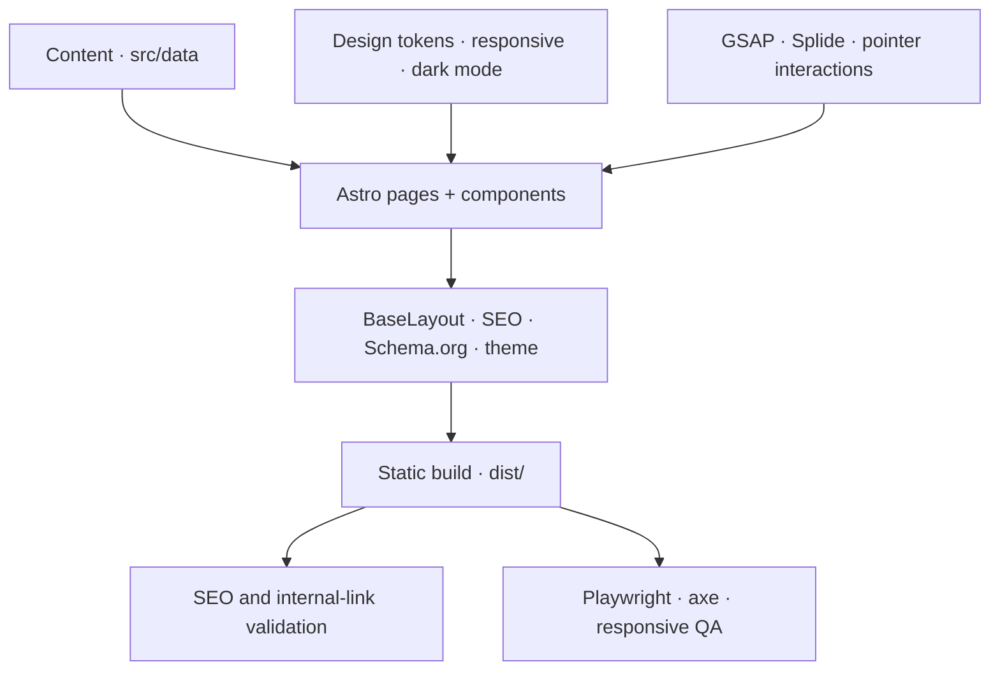

<p align="center">
  <a href="https://nfc.ciwork.co">
    
  </a>
</p>

<h1 align="center">National Filing Corporation</h1>

<p align="center">
  Business formation, filing, and compliance—delivered through a fast, accessible Astro experience.
</p>

<p align="center">
  <a href="https://nfc.ciwork.co">Website</a>
  ·
  <a href="https://nfc.ciwork.co/services/">Services</a>
  ·
  <a href="https://nfc.ciwork.co/pricing/">Pricing</a>
</p>

<p align="center">
  
  
  
  
  
  
  
</p>

## About the product

This repository contains the public website for **National Filing Corporation (NFC)**. It gives founders a clear path through entity formation, registered-agent service, renewals, pricing, and state-specific guidance while keeping every public route fast, indexable, and usable across devices.

The experience includes:

- Six dedicated service journeys for LLCs, C Corporations, S Corporations, nonprofit organizations, business renewals, and registered-agent service.
- An accessible formation intake that prepares a pre-addressed email request without storing visitor data.
- Responsive editorial layouts, an NFC color system, light and dark themes, and purpose-built motion.
- Fourteen statically generated, indexable routes with canonical metadata, structured data, a sitemap, and validated internal links.
- Local, NFC-specific imagery and interaction artwork; the production build has no dependency on third-party reference media.

## Technology

### Active stack

| Layer | Technology | Role |
| --- | --- | --- |
| Application | Astro 7.3.8 | Static pages, layouts, components, routing, and build output |
| Language | TypeScript 6 in strict mode | Typed content models and client behavior |
| Motion | GSAP 3.15 | Choreographed transitions, pointer reactions, and UI micro-interactions |
| Carousels | Splide 4.1 + AutoScroll | Accessible continuous media rails |
| Icons | Phosphor Icons | Consistent interface and service iconography |
| Typography | Inter Variable | Locally bundled variable font under the SIL Open Font License 1.1 |
| Validation | Astro Check | Static analysis and Astro/TypeScript validation |
| Browser QA | Playwright + axe-core | Responsive, overflow, and accessibility testing |

### Prepared integrations

The following packages are pinned for future NFC-owned experiences but are **not active in the shipped interface**:

- `@rive-app/canvas` — ready for original NFC `.riv` artwork. No third-party `.riv` files are included.
- `lenis` — available for controlled scrolling experiments. The current website intentionally uses native scrolling.

## Architecture



Content is defined separately from presentation so service records, navigation, pricing, FAQs, and legal copy remain consistent across the website. Astro composes that data into semantic pages; shared styles and client scripts add the design system and interaction layer; the build produces a deployable static artifact in `dist/`.

## Routes

All fourteen routes below are included in the sitemap and validated as indexable.

### Core experience

| Route | Purpose |
| --- | --- |
| `/` | Main NFC landing page |
| `/services/` | Service directory |
| `/pricing/` | Filing packages and service pricing |
| `/business-formation/` | Formation intake |

### Filing and compliance services

| Route | Purpose |
| --- | --- |
| `/llc-formation/` | LLC formation |
| `/c-corporation/` | C Corporation formation |
| `/s-corporation/` | S Corporation election support |
| `/nonprofit-organization/` | Nonprofit formation and exemption support |
| `/business-renewal/` | Annual reports, renewals, and reinstatement guidance |
| `/registered-agent/` | Registered-agent service |

### State and legal information

| Route | Purpose |
| --- | --- |
| `/browse-by-state/` | State directory; Florida is active and other states are marked as coming soon |
| `/statedetails-florida/` | Florida-specific filing guidance |
| `/terms-and-conditions/` | Terms and conditions |
| `/privacy-policy/` | Privacy policy |

Legacy requests to `/form/` and `/map-test/` redirect to their current local equivalents.

## Repository structure

```text
.
├── public/
│   ├── licenses/              # Public third-party notices
│   └── media/                 # Optimized NFC imagery and service artwork
├── scripts/
│   ├── a11y-check.mjs         # Playwright, axe, and overflow validation
│   ├── seo-check.mjs          # Metadata, schema, sitemap, link, and asset checks
│   └── visual-audit.mjs       # Local visual-review support
├── source-media/              # Ignored archival masters; never published
├── src/
│   ├── components/            # Navigation, sections, service, legal, and conversion UI
│   ├── data/                  # Services, pricing, states, FAQs, and legal content
│   ├── layouts/               # Shared document shell, SEO, schema, and theme bootstrap
│   ├── pages/                 # Static routes and sitemap generation
│   ├── scripts/               # Client motion, menus, theme, forms, and carousels
│   └── styles/                # Tokens, layout systems, dark mode, and responsive rules
├── astro.config.mjs           # Canonical site, trailing slashes, and redirects
├── package.json               # Runtime constraints, dependencies, and scripts
└── tsconfig.json              # Strict TypeScript configuration
```

## Local development

### Requirements

- Node.js `22.12.0` or newer
- npm with lockfile support
- A Chromium-compatible browser for the full browser QA suite

No environment variables or external services are required to build the public website.

### Install and run

Use the committed lockfile for a reproducible installation:

```bash
npm ci
npm run dev
```

Astro serves the local project at `http://127.0.0.1:4321/` by default.

To validate and inspect the production output:

```bash
npm run qa
npm run preview
```

## Scripts

| Command | Description |
| --- | --- |
| `npm run dev` | Starts the Astro development server |
| `npm run check` | Runs Astro and strict TypeScript checks |
| `npm run build` | Generates the static production artifact in `dist/` |
| `npm run preview` | Serves the built artifact locally |
| `npm run qa:seo` | Validates all indexable routes, metadata, schema, links, fragments, sitemap, and public assets |
| `npm run qa:a11y` | Checks desktop and responsive scenarios with Playwright and axe, including horizontal overflow |
| `npm run qa` | Runs checks, build, SEO/link validation, and browser accessibility QA in sequence |

## Experience standards

### Motion

Motion is part of the interface hierarchy, not decoration. GSAP powers card reactions, button feedback, content reveals, pricing interactions, and the geometric closing scene; Splide handles continuous rails. Effects are scoped to suitable pointers and viewports, and expensive work is avoided when it would not improve the experience.

The website independently implements NFC-owned DOM, CSS, and GSAP interaction artwork. No reference-site JavaScript, SVGs, iframes, or proprietary animation files are shipped.

### Dark mode

The interface supports light and dark themes. It honors the visitor's system preference on first load, exposes a manual theme control, and stores that selection in `localStorage` under `nfc-theme`. The theme bootstrap runs before paint to prevent a visible flash of the wrong color scheme.

### Accessibility

- Semantic landmarks, one primary heading per route, keyboard-operable navigation, and visible focus states.
- Accessible service menus, accordions, carousels, forms, and theme controls.
- `prefers-reduced-motion` support throughout the animation system.
- Automated axe and horizontal-overflow checks across every desktop route plus representative responsive dark-mode routes.
- Local alternative text and no essential information conveyed by motion alone.

## SEO and quality gates

Every release candidate should pass:

```bash
npm run qa
npm audit --omit=dev
```

The automated gate confirms:

- The fourteen sitemap entries have generated HTML.
- Titles, descriptions, canonical URLs, robots directives, one `h1`, and JSON-LD are present.
- Internal links, fragment targets, redirects, and local assets resolve.
- Representative desktop, tablet, and mobile views have no detected horizontal overflow.
- Automated axe scans report no accessibility violations in the tested scenarios.

Automated checks complement—rather than replace—manual review of content, motion, visual hierarchy, keyboard behavior, and real-device rendering.

## Build and deployment

```bash
npm ci
npm run qa
```

Deploy the generated `dist/` directory to any static host. The canonical origin is configured as `https://nfc.ciwork.co`, HTML is compressed, and public URLs use trailing slashes. The host should serve redirects declared in `astro.config.mjs` or preserve the generated redirect behavior supported by the target platform.

## Privacy and current limitations

- The site has no application backend, database, account system, or analytics integration in this repository.
- Formation intake data is composed into a `mailto:` link and handed to the visitor's email client. The website itself does not transmit or retain the form data.
- The public build does not require secrets or environment variables.
- Florida has a detailed state page today. Other state entries remain visible as coming-soon destinations until their content is prepared and reviewed.
- Service descriptions provide general filing information and are not a substitute for legal, tax, or accounting advice.

## Assets and provenance

- Public photography, service imagery, icons, geometric artwork, copy, and interactions are NFC-specific.
- Optimized deployable assets live under `public/media/` and are included in the static build.
- Archival masters, prompts, and retired campaign media live under the ignored `source-media/` directory and never ship to production.
- The previous overview video is intentionally excluded from `public/`; the landing page does not duplicate it across sections.
- No third-party reference photography, SVG, JavaScript, iframe, or `.riv` artwork is bundled or fetched at runtime.
- Runtime assets are served locally; the README badges are documentation-only images displayed by GitHub.

## Licensing

Inter Variable is distributed under the **SIL Open Font License 1.1**. Its public notice is available at [`public/licenses/inter-OFL-1.1.txt`](./public/licenses/inter-OFL-1.1.txt) and is copied into the production build.

Third-party npm packages remain subject to the licenses declared by their respective maintainers. NFC-specific source code, copy, brand assets, and media are proprietary unless National Filing Corporation states otherwise in writing. This repository does not grant a general open-source license.

---

<p align="center">
  <strong>National Filing Corporation</strong><br />
  A clear foundation for the business you are building.
</p>
